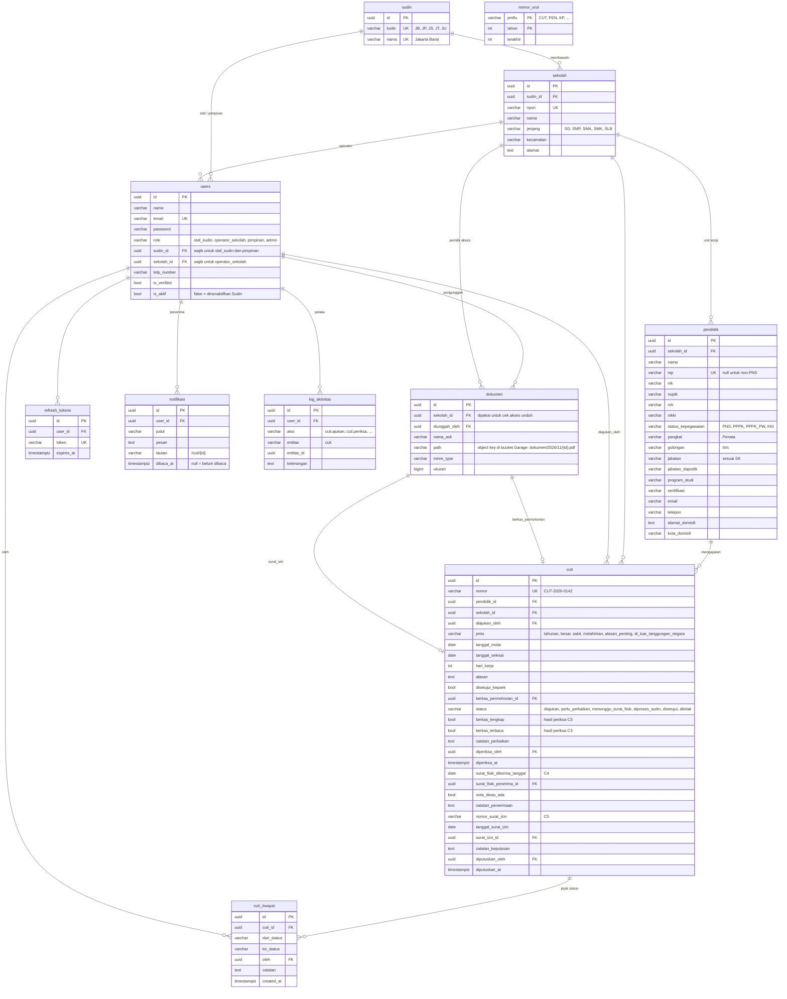
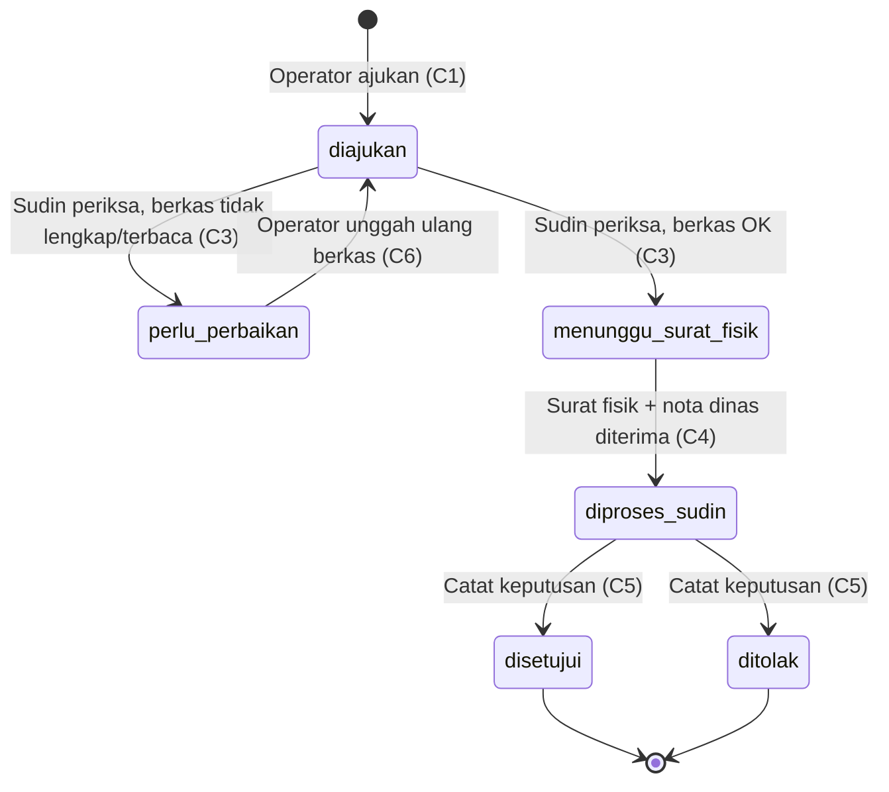

# ERD Teralur: Fondasi + Cuti

Cakupan: fondasi (wilayah Sudin, sekolah, pendidik, akun, berkas, notifikasi, log aktivitas, nomor registrasi) dan modul Cuti (alur C1–C6 di Figma Teralur v0.9). Modul lain (Pensiun, Kenaikan Pangkat, dan seterusnya) akan menempel ke tabel fondasi yang sama.

## Alur status Cuti

## Catatan desain

- **Satu baris per pengajuan.** Langkah C3–C5 masing-masing terjadi sekali per pengajuan, jadi kolomnya disimpan langsung di `cuti`. Jejak lengkapnya (termasuk perbaikan berulang) ada di `cuti_riwayat`.
- **Scope akses.** Staf Sudin dan Pimpinan hanya melihat sekolah di Sudin-nya, Operator hanya melihat sekolahnya sendiri. `cuti.sekolah_id` disimpan ulang (denormalisasi) supaya filter antrean tidak perlu join ke `pendidik`.
- **Nomor registrasi.** `nomor_urut` dinaikkan secara atomik (`INSERT ... ON CONFLICT DO UPDATE ... RETURNING`), lalu dipakai bersama oleh modul lain dengan prefix berbeda.
- **Akun.** Tidak ada pendaftaran mandiri. Staf Sudin membuat akun operator sekolah dan sesama staf di wilayahnya; akun pimpinan dan admin dibuat admin. Akun tidak dihapus, hanya dinonaktifkan (`is_aktif = false`), supaya jejak `cuti_riwayat` dan `log_aktivitas` tetap utuh.
- **Berkas.** Isi file disimpan di object storage Garage (S3-compatible, bucket privat). Tabel `dokumen` hanya menyimpan metadata dan object key. Unduhan lewat `GET /api/dokumen/{id}` dengan cek akses berdasarkan `dokumen.sekolah_id`.
- **Sisa cuti tahunan.** Jatah 12 hari kerja per tahun dikurangi cuti tahunan yang belum ditolak. Hari kerja dihitung Senin–Jumat. Libur nasional, cuti bersama, dan akumulasi sisa tahun lalu belum dihitung.
- **Keputusan final.** Setelah `disetujui` atau `ditolak`, pengajuan tidak bisa diubah (sesuai peringatan di layar C5).
