# ERD Teralur

Bagian pertama: fondasi (wilayah Sudin, sekolah, pendidik, akun, berkas, notifikasi, log aktivitas, nomor registrasi) dan modul Cuti (alur C1–C6 di Figma Teralur v0.9). Bagian selanjutnya: satu modul per bagian, semuanya menempel ke tabel fondasi yang sama. Kolom baru di fondasi sejak versi awal: `users.username`, `users.nip`, `pendidik.tanggal_lahir`, `pendidik.tmt_cpns`, `pendidik.tmt_golongan` (syarat 4 tahun kenaikan pangkat), `sekolah.kepala_sekolah`, dan kontak layanan di `sudin`.

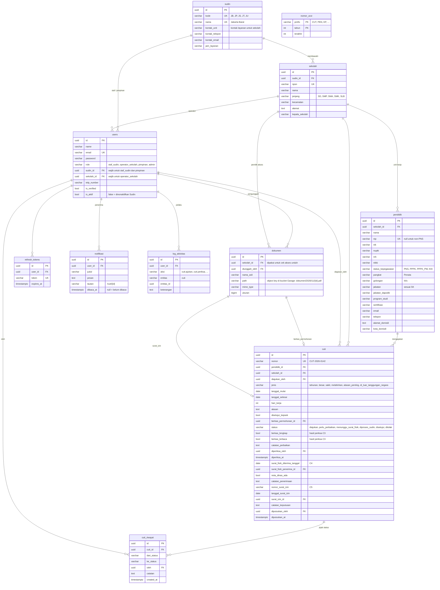

## Alur status Cuti

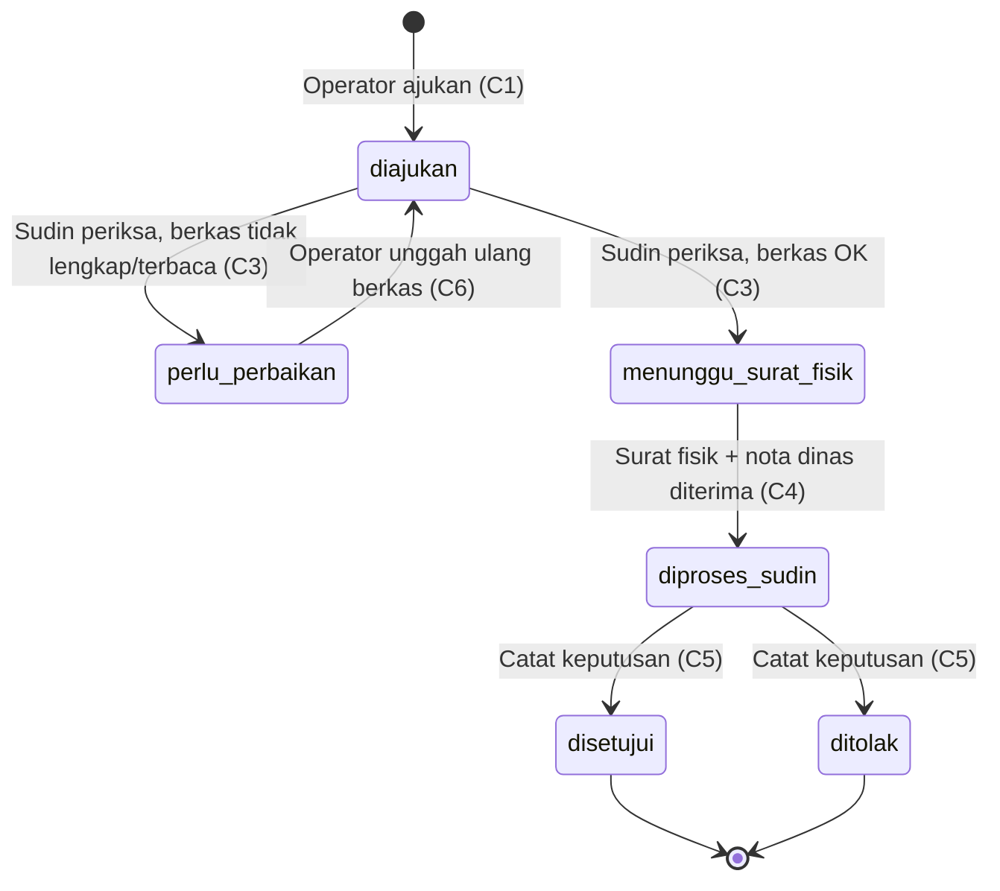

## Catatan desain

- **Satu baris per pengajuan.** Langkah C3–C5 masing-masing terjadi sekali per pengajuan, jadi kolomnya disimpan langsung di `cuti`. Jejak lengkapnya (termasuk perbaikan berulang) ada di `cuti_riwayat`.
- **Scope akses.** Staf Sudin dan Pimpinan hanya melihat sekolah di Sudin-nya, Operator hanya melihat sekolahnya sendiri. `cuti.sekolah_id` disimpan ulang (denormalisasi) supaya filter antrean tidak perlu join ke `pendidik`.
- **Nomor registrasi.** `nomor_urut` dinaikkan secara atomik (`INSERT ... ON CONFLICT DO UPDATE ... RETURNING`), lalu dipakai bersama oleh modul lain dengan prefix berbeda.
- **Akun.** Tidak ada pendaftaran mandiri. Staf Sudin membuat akun operator sekolah dan sesama staf di wilayahnya; akun pimpinan dan admin dibuat admin. Akun tidak dihapus, hanya dinonaktifkan (`is_aktif = false`), supaya jejak `cuti_riwayat` dan `log_aktivitas` tetap utuh.
- **Berkas.** Isi file disimpan di object storage Garage (S3-compatible, bucket privat). Tabel `dokumen` hanya menyimpan metadata dan object key. Unduhan lewat `GET /api/dokumen/{id}` dengan cek akses berdasarkan `dokumen.sekolah_id`.
- **Sisa cuti tahunan.** Jatah 12 hari kerja per tahun dikurangi cuti tahunan yang belum ditolak. Hari kerja dihitung Senin–Jumat. Libur nasional, cuti bersama, dan akumulasi sisa tahun lalu belum dihitung.
- **Keputusan final.** Setelah `disetujui` atau `ditolak`, pengajuan tidak bisa diubah (sesuai peringatan di layar C5).

---

## Modul Pensiun

## Pensiun

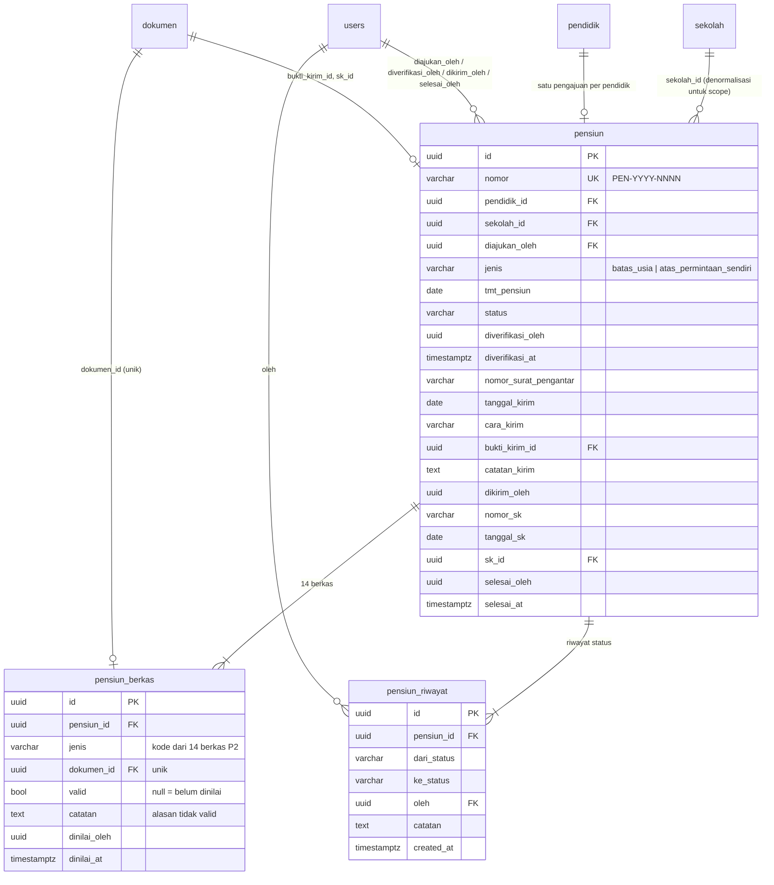

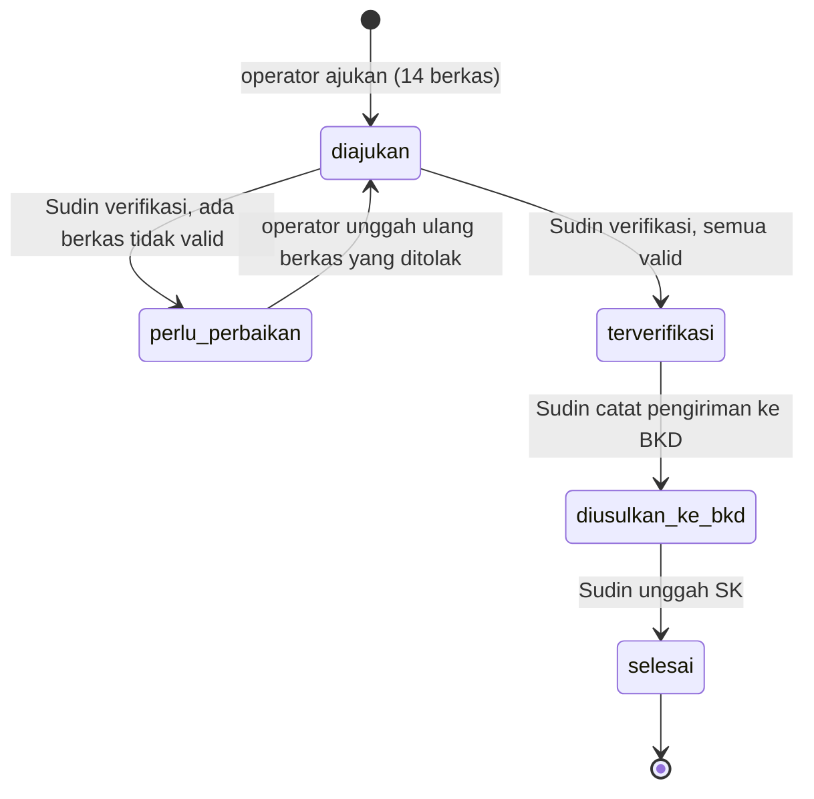

Catatan desain:
- Berkas diunggah satu per satu (`POST /api/pensiun/berkas`) lalu dirujuk lewat id saat mengajukan; 14 PDF × 2 MB tidak muat di batas body multipart 11 MiB.
- Penilaian disimpan per baris `pensiun_berkas`. Perbaikan mengganti `dokumen_id` pada baris yang tidak valid dan mengosongkan penilaiannya; dokumen lama tetap ada di tabel `dokumen`.
- `dokumen_id` unik per tabel berkas, jadi satu dokumen tidak bisa dipakai dua pengajuan pensiun.
- Struktur kolom penilaian (`BerkasPersyaratan`) dan logikanya (`pkg/persyaratan`) dipakai bersama dengan Kenaikan Pangkat; tabelnya terpisah.

---

## Modul Kenaikan Pangkat

## Kenaikan Pangkat

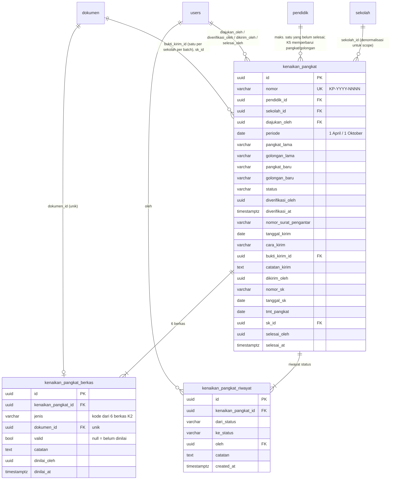

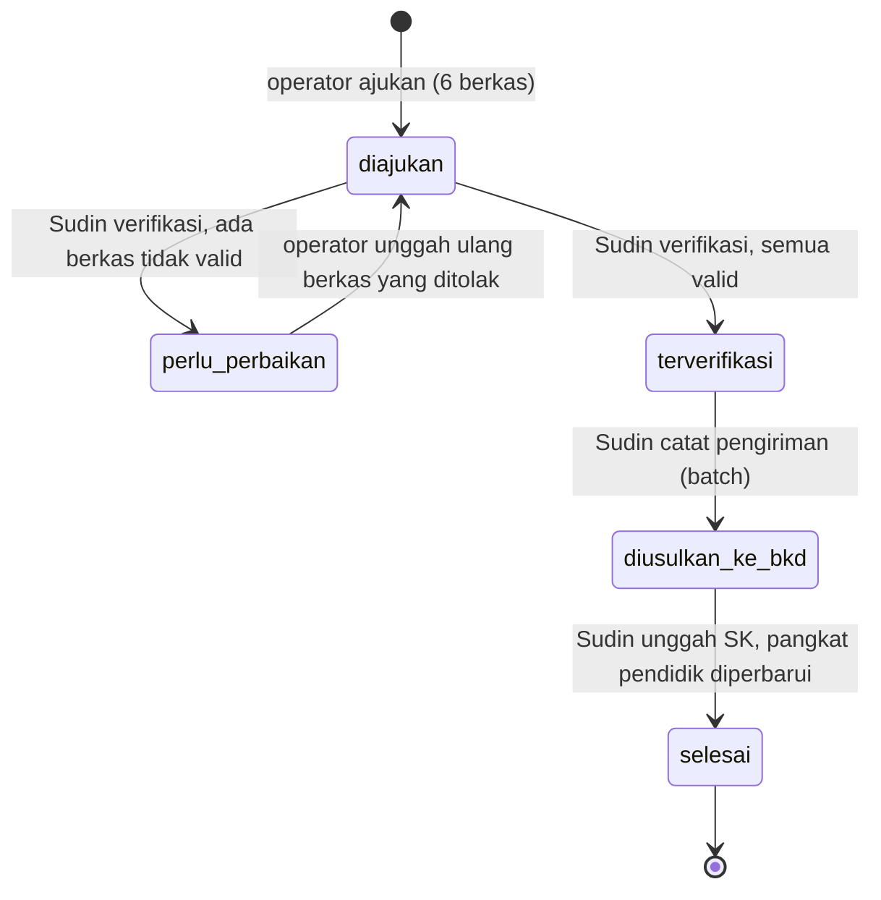

Catatan desain:
- Pangkat/golongan lama dan baru disalin ke baris usulan saat mengajukan, supaya riwayat tetap benar setelah data induk berubah.
- K5 mengunci baris pendidik (`FOR UPDATE`) dan hanya memperbarui `pangkat`, `golongan`, `updated_at`; perubahan dicatat di `log_aktivitas` (`pendidik.ubah_pangkat`).
- Pengiriman BKD (K4) bersifat batch dan all-or-nothing seperti "terima surat fisik" di Cuti.
- Struktur kolom penilaian (`BerkasPersyaratan`) dan logikanya (`pkg/persyaratan`) dipakai bersama dengan Pensiun; tabelnya terpisah.

---

## Modul Sikap Disiplin

## Sikap Disiplin

Kasus dugaan pelanggaran disiplin (Figma DS1–DS9). Satu baris `disiplin` per kasus; semua tahap (verifikasi, pemeriksaan, rekomendasi, keputusan pimpinan, keputusan final, tindak lanjut) disimpan sebagai kolom di baris yang sama. Berkas ditautkan lewat `disiplin_berkas`, jejak status di `disiplin_riwayat`.

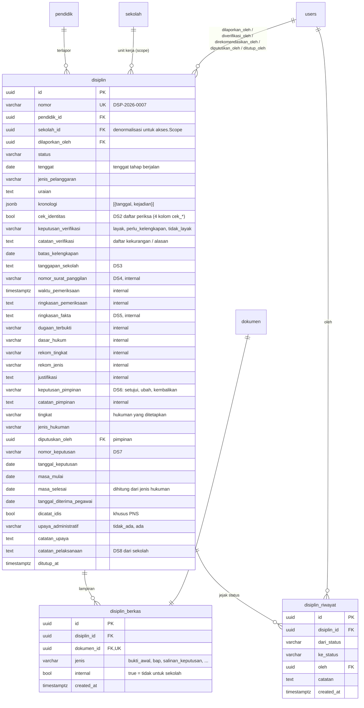

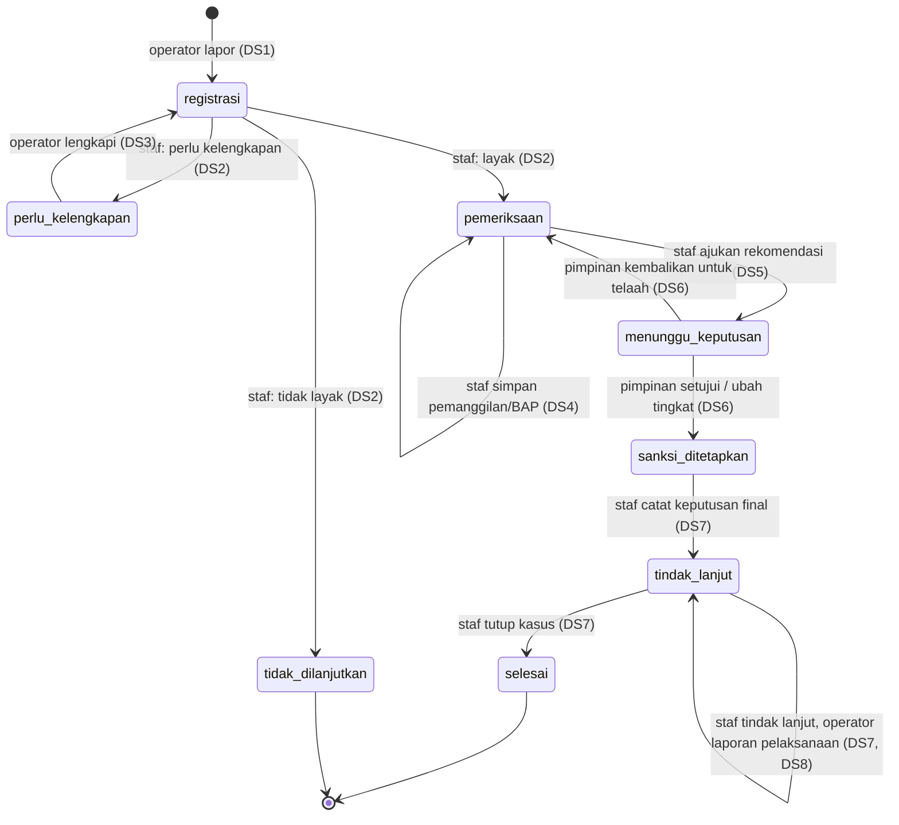

Catatan desain:

- Akses: semua query lewat `akses.Scope(actor, "disiplin.sekolah_id")`; di luar scope = 404. Penetapan keputusan (DS6) hanya `pimpinan` (route), staf dan admin mendapat 403.
- Kerahasiaan: kolom bertanda "internal" dan berkas `internal=true` (BAP, tanggapan pegawai, bukti tambahan, bukti penyampaian) tidak dikirim ke `operator_sekolah`. Dokumen internal disimpan dengan `dokumen.sekolah_id = NULL` sehingga tidak bisa diunduh sekolah lewat `/api/dokumen/{id}`; semua berkas kasus diunduh lewat `/api/disiplin/{id}/dokumen/{dokumen_id}`.
- Kolom tahap disimpan rata di satu tabel (tanpa tabel per tahap) karena tiap tahap hanya terjadi sekali per kasus; pengembalian oleh pimpinan menimpa rekomendasi lama, jejaknya tetap di `disiplin_riwayat`.

---

## Modul Generator Surat

## Generator Surat

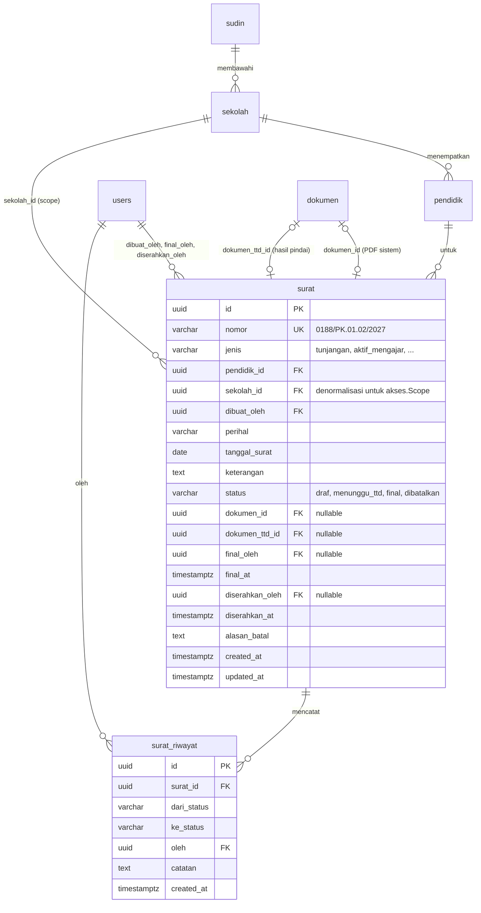

### Alur status Generator Surat

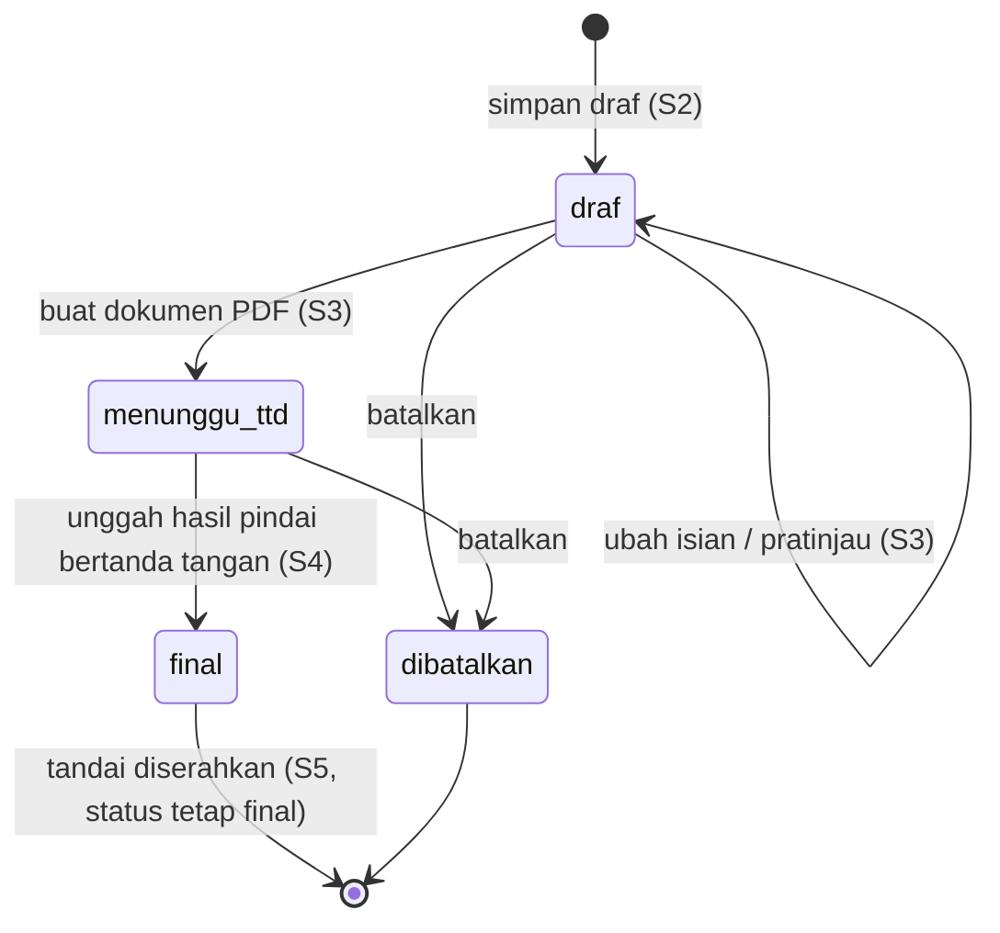

Catatan desain:

- Template surat (judul, pembuka, penutup, awalan nama berkas) ada di `modules/surat/service/template.go`, satu entri per jenis. Isian `keterangan` dari form disisipkan apa adanya; data guru (nama, NIP, pangkat/golongan, jabatan, unit kerja) diambil dari master pendidik saat PDF dirender.
- Kop dan penanda tangan diturunkan dari Sudin sekolah pendidik, tidak disimpan di tabel.
- Nomor surat urut per tahun tanggal surat lewat `nomor_urut` (prefix `SRT`), format `NNNN/PK.01.02/YYYY`. Nomor isian manual boleh, unik global.
- PDF sistem dan hasil pindai disimpan di tabel `dokumen` dengan `sekolah_id` pendidik, jadi ikut aturan akses unduh dokumen yang sudah ada.

---

## Modul Analisis Jabatan

## Analisis Jabatan (Anjab)

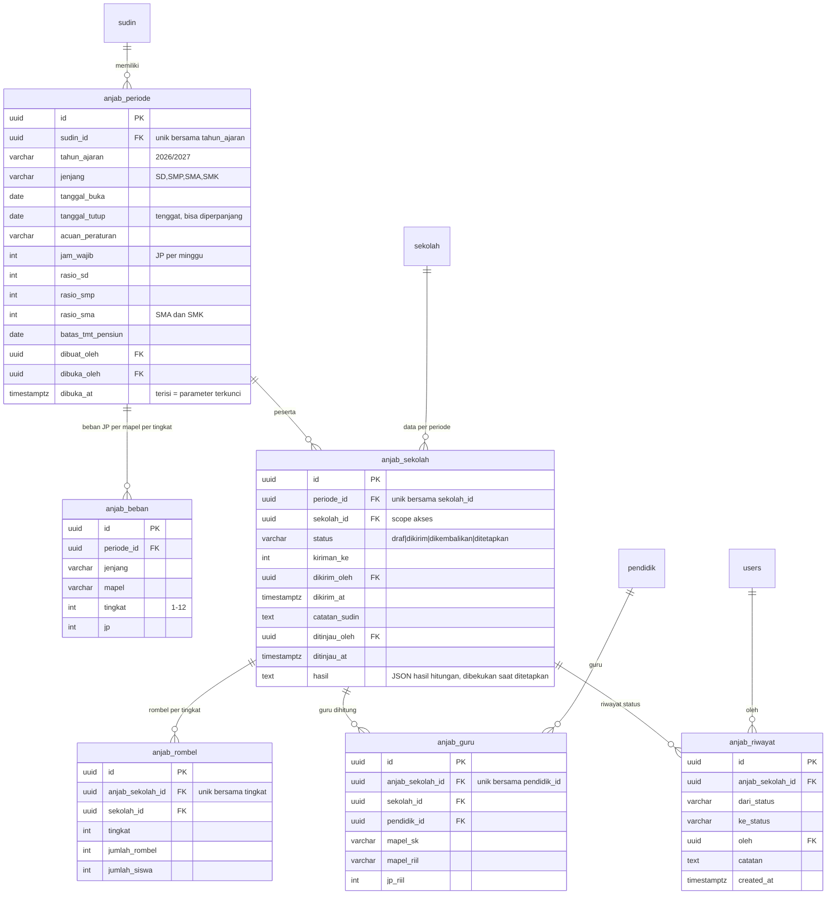

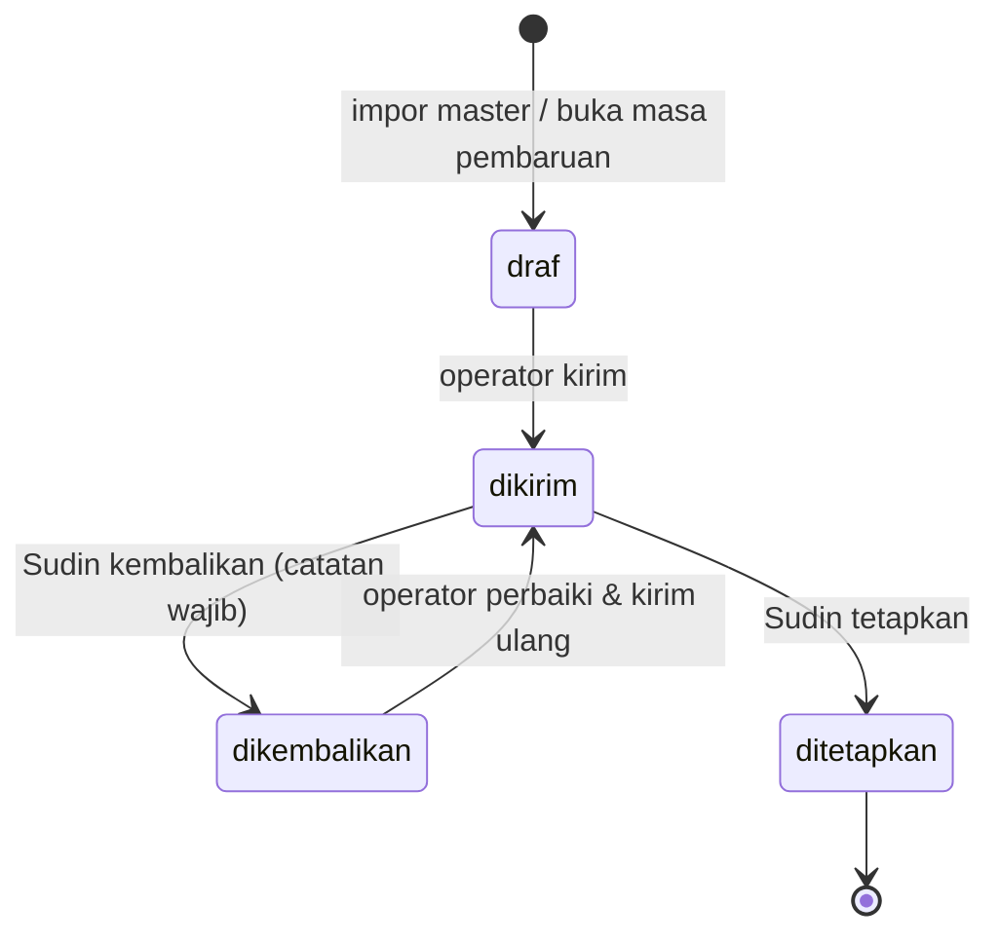

Catatan desain:

- Periode milik satu Sudin (`anjab_periode.sudin_id` diambil dari akun staf, bukan dari body). Akses periode: staf/pimpinan
  Sudin itu, operator sekolah di Sudin itu, admin semua. Data per sekolah (`anjab_sekolah`, `anjab_rombel`, `anjab_guru`)
  memakai `sekolah_id` dan `akses.Scope`; di luar scope = 404.
- Parameter dan beban JP terkunci setelah `dibuka_at` terisi. Impor master hanya sebelum masa pembaruan dibuka.
- Hitungan adalah fungsi murni di `modules/anjab/hitung` (dua basis: mapel SK dan mapel riil). Sebelum ditetapkan, hasil
  dihitung ulang dari data terkini; saat ditetapkan hasilnya disimpan sebagai JSON di `anjab_sekolah.hasil` sehingga
  perubahan pendidik (mis. tanggal lahir) atau mutasi kemudian tidak mengubah hasil yang sudah ditetapkan.
- Guru hasil impor di-upsert ke tabel `pendidik` (berdasar NIP; tanpa NIP berdasar nama di sekolah yang sama).
- Monitoring (A6) hanya memakai sekolah yang sudah ditetapkan, versi kondisi riil.

---

## Modul Layanan Dapodik

## Layanan Dapodik

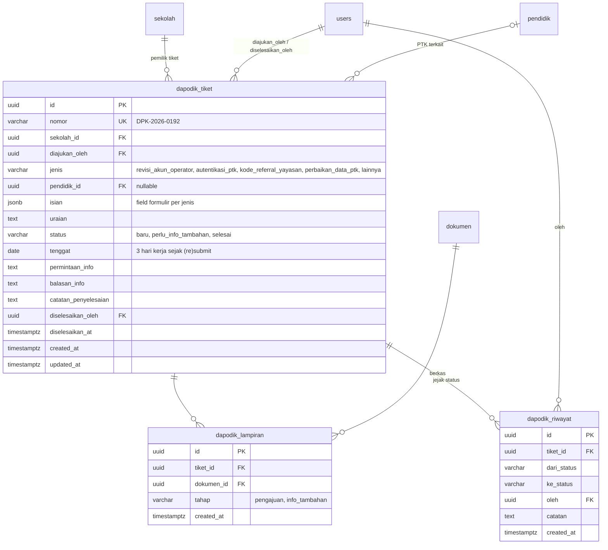

### Alur status Layanan Dapodik

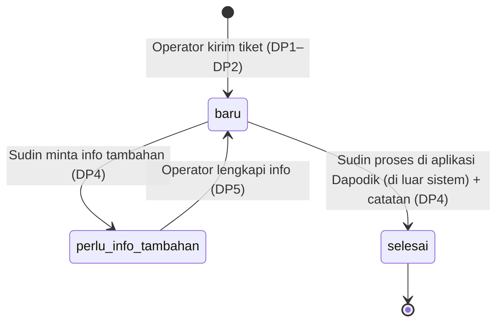

### Catatan desain

- **Formulir per jenis di `isian` (jsonb).** Lima jenis layanan punya field berbeda dan hanya DP2 (revisi akun operator) yang dirinci di Figma. Satu kolom jsonb `map[string]string` lebih sederhana daripada tabel per jenis; field wajib divalidasi di service.
- **Lampiran banyak.** Tiket bisa punya beberapa berkas (SK penunjukan + surat permohonan, lalu dokumen pendukung saat melengkapi), jadi dipisah ke `dapodik_lampiran` dengan `tahap`.
- **Scope.** `dapodik_tiket.sekolah_id` diambil dari penempatan operator (bukan dari body); staf dan pimpinan dibatasi Sudin lewat `akses.Scope`.
- **Tenggat.** Kolom `tenggat` (date) diisi 3 hari kerja setelah tiket masuk atau dilengkapi ulang, dipakai untuk urutan antrean DP3 dan penanda `terlambat`.
- **Final.** Status `selesai` tidak bisa diubah lagi.

---

## Modul Kinerja P3K Paruh Waktu

## Kinerja P3K Paruh Waktu

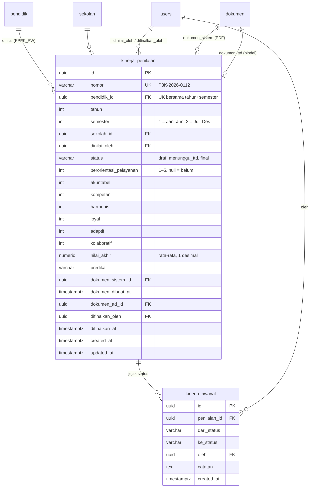

### Alur status Kinerja P3K PW

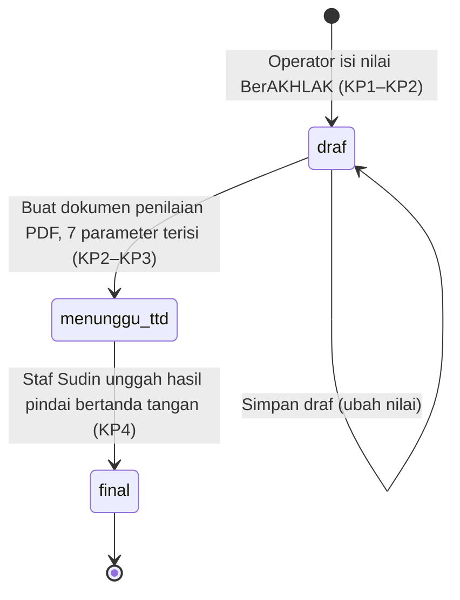

### Catatan desain

- **Satu penilaian per pegawai per periode.** Unique index `(pendidik_id, tahun, semester)`; pembuatan juga mengunci baris pendidik lalu mengecek dulu supaya pesan 409 jelas.
- **Tujuh kolom nilai.** Parameter BerAKHLAK tetap (dari KP2), jadi disimpan sebagai kolom `int` nullable, bukan tabel detail. `nilai_akhir` dan `predikat` dihitung ulang setiap simpan.
- **Dua dokumen.** `dokumen_sistem_id` = PDF yang dibuat server (go-pdf/fpdf, disimpan lewat `dokumen.SimpanBytes`); `dokumen_ttd_id` = hasil pindai bertanda tangan yang diunggah staf Sudin. Keduanya ber-`sekolah_id` sekolah pegawai sehingga operator sekolah itu dan staf Sudin-nya bisa mengunduh.
- **Final.** Status `final` tidak bisa diubah; nilai hanya bisa diubah saat `draf`.

---

## Modul Arsip Kepegawaian

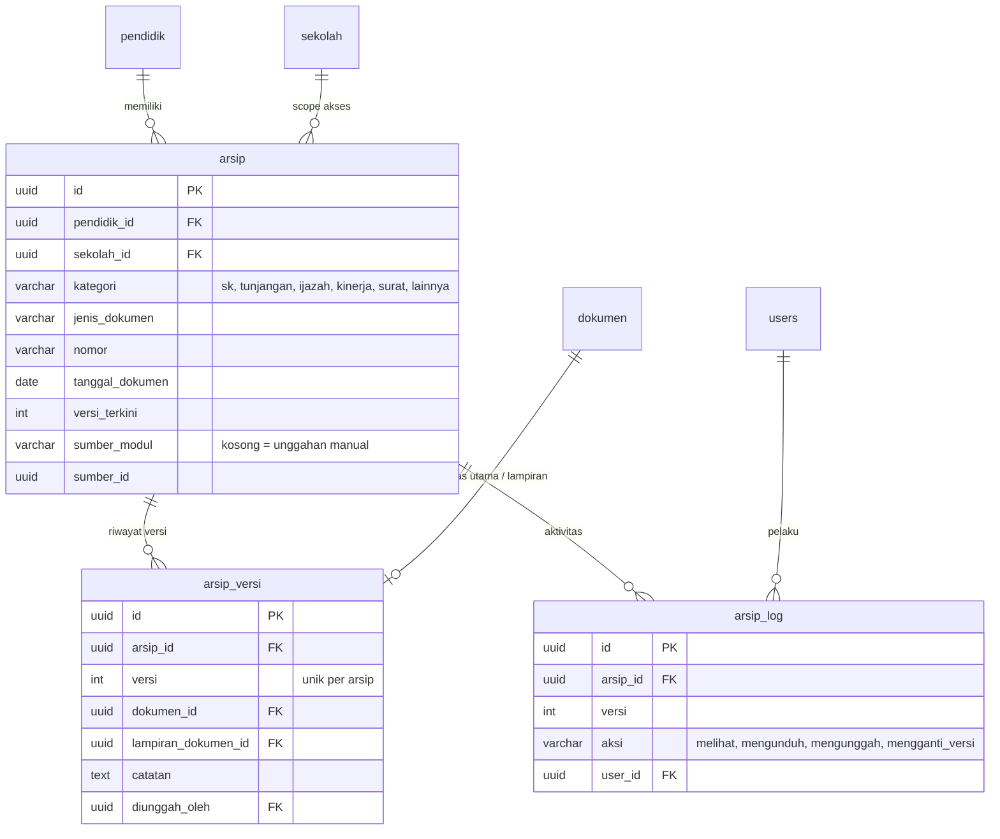

Dokumen final dari modul lain masuk lewat `pkg/arsipkan.Otomatis` di transaksi yang sama dengan langkah final modul tersebut. Kasus disiplin tidak diarsipkan di sini karena bersifat terbatas.

---

## Modul Dasbor Lintas Modul

Dasbor tidak punya tabel sendiri. Ia membaca tabel modul (cuti, pensiun, kenaikan_pangkat, disiplin, dapodik_tiket, kinerja_penilaian, surat, anjab_sekolah) dengan scope peran yang sama. Spesifikasi status dan tugas per modul ada di `modules/dasbor/spek`.
